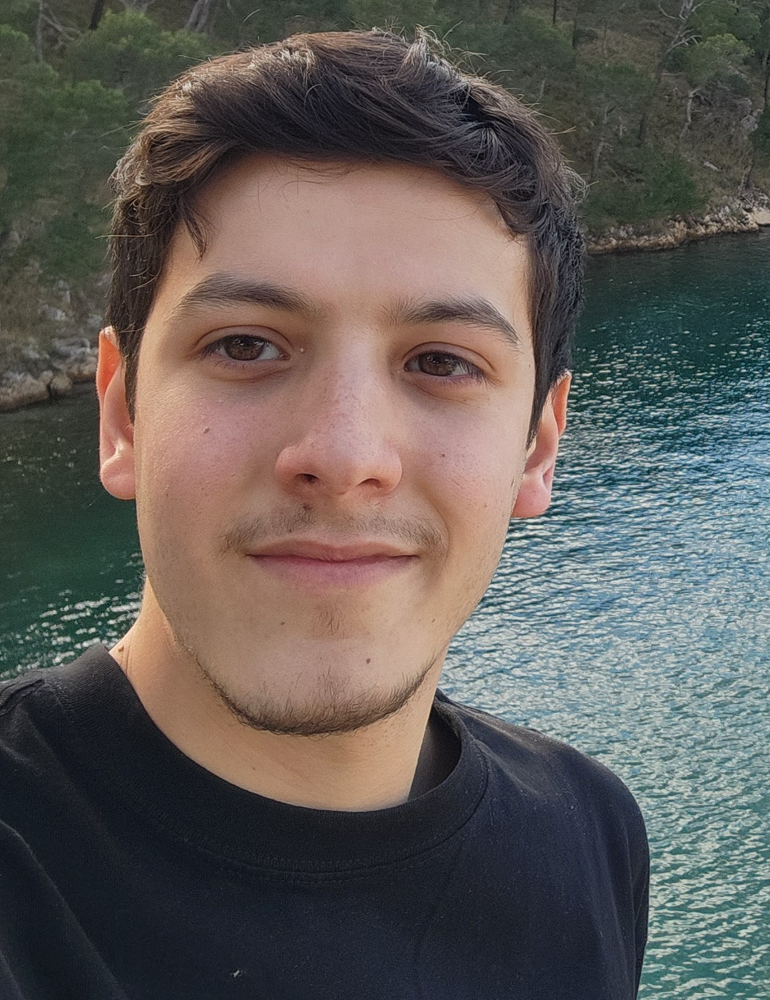

# About Me

Hi! I am a Computer Scientist from the University of Buenos Aires (UBA) && Software Developer.

I am interested in Compilers development, ML and HPC.

For several years, I have been working as a Freelance Software Developer, working on services with over 250k active users.

Outside of work, I practice calisthenics, play foosbal (metegol as we call it in Argentina), and enjoy mountaineering.

## Experience

- **Graduate Teaching Assistant – Programming Languages Paradigms**, Faculty of Exact and Natural Sciences, UBA · August 2026 – Present
- **Research Intern – High-Performance Computing**, [Instituto de Ciencias de la Computación, HPC Lab](https://www.hpclatam.org/), UBA · March 2026 – Present
- **Teaching Assistant – Algorithms and Data Structures**, Faculty of Exact and Natural Sciences, UBA · March 2025 – Present
- **Software Developer**, [MRM Analytics](https://www.mrmanalytics.com/) · May 2025 – December 2025
- **Mobile & Backend Developer**, Freelance (Full occupation) · March 2023 – May 2025
- **Full Stack Developer**, [4i Platform](https://www.4iplatform.com/) · October 2020 – July 2022

## Projects I contributed to

- **[Orbis](https://github.com/orbis-geonet)**, An open-source social network for mapping digital tribes, developed as a federated system.
- **[Going Solo](https://www.goingsolo.app/)**, A social app that connects solo travelers to meet fellow travelers, plan trips, and share travel experiences.
- **[FRISCV](https://github.com/friscv/)**, A 32-bit RISC-V SoC.
- **[Copy Me That](https://www.copymethat.com/)**, A web app that allows users to save and organize recipes from the web on their mobile devices.

---

## News

- **Sep 2026**: Presenting a talk about compilers for DL models in Rosario at [JCC 2026](https://jcc.dcc.fceia.unr.edu.ar/).
- **Sep 2026**: Presenting my HPC work on DL models optimization for RISC-V in Cordoba at [CARLA 2026](https://carlaconference.org/).
- **Mar 2026**: Moving back to Buenos Aires to continue my research at [ICC](https://icc.fcen.uba.ar).
- **Jun 2025**: I was selected for an HPC internship at [FER](https://www.fer.unizg.hr) under an Erasmus+ mobility program.
